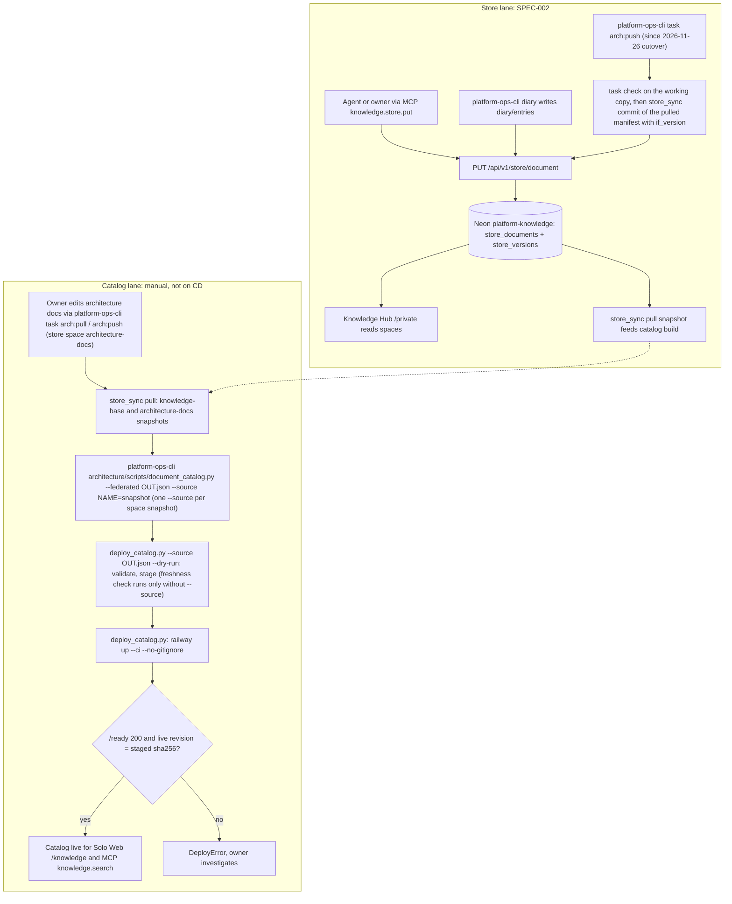
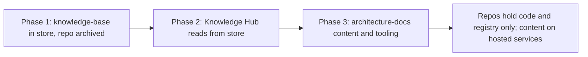

# 01 — Business process (As-Is / To-Be)

platform-knowledge-api เป็น service เดียวที่ทำสองงาน: (1) ให้ค้น **metadata** ของ document catalog (สร้างจาก architecture-docs แล้ว deploy แยก ไม่อยู่ใน git) และ (2) ตั้งแต่ 2026-11-03 เป็น **hosted document store** (SPEC-002) ที่เก็บตัวเอกสารพร้อม version history ใน Postgres และตั้งแต่ SPEC-003 ทุก write ที่เพิ่ม version จะลง `store_outbox` ใน transaction เดียวกัน แล้ว relay ส่งเข้า Kafka `platform.events.v1`

Last reviewed: 2026-11-26 · commit `d3be116`

## As-Is (จากโค้ดและ ops record วันนี้)

Sources: `README.md` (Deploy, Document store), `PRODUCT.md`, `scripts/deploy_catalog.py`, `scripts/store_sync.py`, platform-ops-cli `architecture/scripts/arch_store.py` and `architecture/scripts/document_catalog.py`, `server.py`, `document_store.py`, `knowledge_mcp.py`, `specs/002-document-store/spec.md`, hub registry `repository-catalog/registries/capabilities.yaml` (architecture-docs row, hub commit `787b222`), ops record: knowledge-api-hosted (2026-11-03), ops record: hosted-document-store (2026-11-03)

## To-Be (จาก specs/002-document-store/spec.md และ ops record เท่านั้น)

SPEC-002 วางไว้ 3 phase: phase 1 knowledge-base (ทำแล้ว 2026-11-03, repo archive แล้ว), phase 2 Knowledge Hub อ่านจาก store, phase 3 architecture-docs และ tooling ย้ายเข้า store

Sources: `specs/002-document-store/spec.md` §1, §2, ops record: hosted-document-store (2026-11-03)

หมายเหตุ: ops record ระบุว่า 2026-11-03 owner ตัดสินใจเพิ่มว่า architecture-docs ยังเป็น Git-first (one-way mirror) และ Knowledge Hub public pages ยังอยู่ใน Git ซึ่งขัดกับ phase 2/3 ใน SPEC-002 ส่วนที่ว่า architecture-docs เป็น Git-first ถูกแทนแล้วด้วย cutover phase 3 วันที่ 2026-11-26 (G4) ส่วนหน้า public ของ Knowledge Hub ที่อยู่ใน Git ยังไม่มีหลักฐานว่าเปลี่ยน (G3)

## Gap

| ID | As-Is → To-Be | Status | Owner | Evidence |
|---|---|---|---|---|
| G1 | knowledge-base content in Git → in the store, repo archived (phase 1) | done | claude | `specs/002-document-store/spec.md`, ops record: hosted-document-store (2026-11-03) |
| G2 | other systems poll for changes → store events through an outbox to Kafka and Bronze | done | claude | `specs/003-event-outbox/spec.md` |
| G3 | Knowledge Hub public pages from Git → read from the store (phase 2) | decide | owner | SPEC-002 §1 vs owner decision 2026-11-03 "architecture-docs stays Git-first" |
| G4 | architecture-docs content and tooling in Git → content in store space `architecture-docs`, tooling in `platform-ops-cli` (phase 3) | done | claude | hub registry `capabilities.yaml` architecture-docs row, hub commit `787b222` (cutover 2026-11-26; Git repo read-only at `263ebe9`) |
| G5 | catalog deploy is manual → scheduled or CD | decide | owner | no written To-Be; `scripts/deploy_catalog.py` |

## Open questions

- หลัง cutover 2026-11-26 สคริปต์ build catalog อยู่ที่ใดใน `platform-ops-cli` และ deploy catalog ยังเป็นขั้น manual เดิมหรือไม่ [ต้องยืนยัน]
- phase 3 เสร็จแล้ว (G4); phase 2 (Knowledge Hub public pages อ่านจาก store) ยังเป็นแผนอยู่หรือไม่ spec ยังไม่ได้อัปเดต
- Catalog lane ยังเป็น manual ทั้งหมด: จะมี schedule หรือ CD สำหรับ catalog หรือไม่
