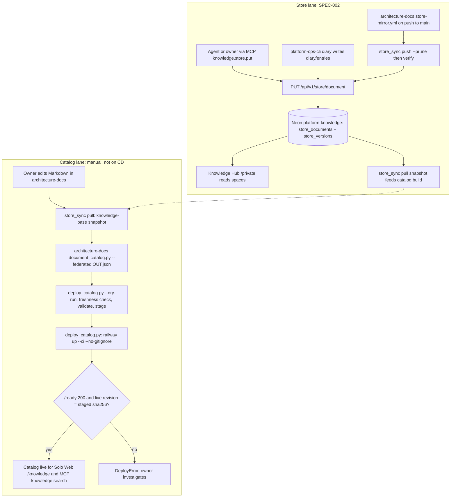
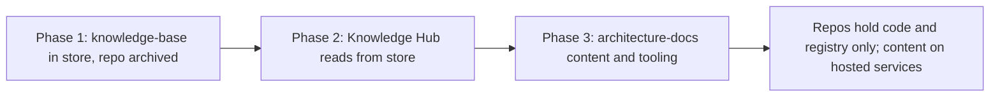

# 01 — Business process (As-Is / To-Be)

platform-knowledge-api เป็น service เดียวที่ทำสองงาน: (1) ให้ค้น **metadata** ของ document catalog (สร้างจาก architecture-docs แล้ว deploy แยก ไม่อยู่ใน git) และ (2) ตั้งแต่ 2026-11-03 เป็น **hosted document store** (SPEC-002) ที่เก็บตัวเอกสารพร้อม version history ใน Postgres

## As-Is (จากโค้ดและ ops record วันนี้)

Sources: `README.md` (Deploy, Document store), `PRODUCT.md`, `scripts/deploy_catalog.py`, `scripts/store_sync.py`, `server.py`, `document_store.py`, `knowledge_mcp.py`, `specs/002-document-store/spec.md`, architecture-docs `.github/workflows/store-mirror.yml`, ops record: knowledge-api-hosted (2026-11-03), ops record: hosted-document-store (2026-11-03)

## To-Be (จาก specs/002-document-store/spec.md และ ops record เท่านั้น)

SPEC-002 วางไว้ 3 phase: phase 1 knowledge-base (ทำแล้ว 2026-11-03, repo archive แล้ว), phase 2 Knowledge Hub อ่านจาก store, phase 3 architecture-docs และ tooling ย้ายเข้า store

Sources: `specs/002-document-store/spec.md` §1, §2, ops record: hosted-document-store (2026-11-03)

หมายเหตุ: ops record ระบุว่า 2026-11-03 owner ตัดสินใจเพิ่มว่า architecture-docs ยังเป็น Git-first (one-way mirror) และ Knowledge Hub public pages ยังอยู่ใน Git ซึ่งขัดกับ phase 2/3 ใน SPEC-002

## Open questions

- SPEC-002 phase 2/3 ยังเป็นแผนอยู่หรือถูกแทนด้วยการตัดสินใจ 2026-11-03 ("architecture-docs stays Git-first")? spec ยังไม่ได้อัปเดต
- Catalog lane ยังเป็น manual ทั้งหมด: จะมี schedule หรือ CD สำหรับ catalog หรือไม่
