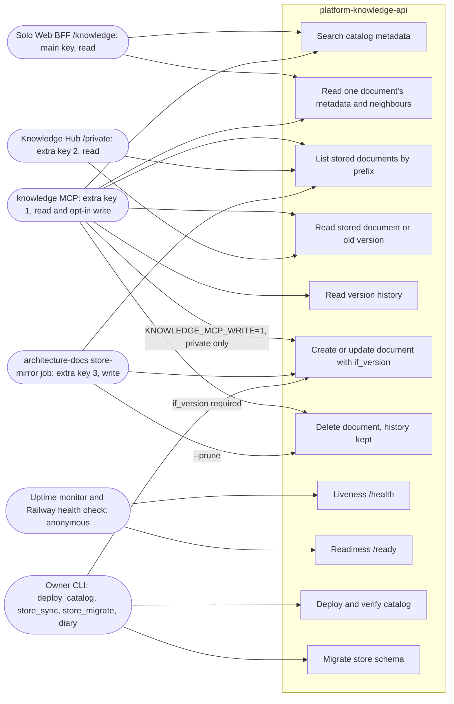

# 02 — Use cases

Actors มาจาก auth จริงในโค้ด: ทุก route ใต้ `/api/v1/` ต้องมี RS256 JWT (`aud=knowledge-api`, `tenant_id=owner`, `sub` อยู่ใน allowlist) และแยก scope `knowledge:read` / `knowledge:write`; key ที่ trust คือ `KNOWLEDGE_API_AUTH_PUBLIC_KEY` (Solo Web) + PEM หลาย block ใน `KNOWLEDGE_API_AUTH_EXTRA_PUBLIC_KEY`

Sources: `server.py` (`KnowledgeApi.__init__`, `_store_route`, `handle`), `vendor/service-auth/service_auth/__init__.py` (`AuthPolicy.from_env`, `check_read_auth`), `knowledge_mcp.py` (`build_server`, `StorePut`, `StoreDelete`, `main`), `scripts/deploy_catalog.py`, `scripts/store_sync.py`, `scripts/store_migrate.py`, `.railway/railway.ts`, `PRODUCT.md` (Users), ops record: hosted-document-store (2026-11-03) for which PEM block belongs to which caller

## Rules seen in code

| Rule | Where |
|---|---|
| read token ใช้เขียนไม่ได้ และ write token ใช้อ่านไม่ได้ (policy แยกตาม scope) | `server.py` `write_policy`, `tests/test_store_http.py::test_writes_need_the_write_scope_and_reads_the_read_scope` |
| MCP เขียนได้เฉพาะ `visibility: private`; delete ต้องส่ง `if_version` | `knowledge_mcp.py` `StorePut`, `StoreDelete` |
| static `KNOWLEDGE_API_TOKEN` ใช้ได้เฉพาะ development | `README.md`, `tests/test_server.py::test_static_token_is_never_production_authorization` |

## Open questions

- การ map PEM block → caller (MCP / Knowledge Hub / sync) มาจาก ops record เท่านั้น ในโค้ดไม่มีชื่อ caller ต่อ key: API แยก caller ไม่ได้ใน log หรือ audit
