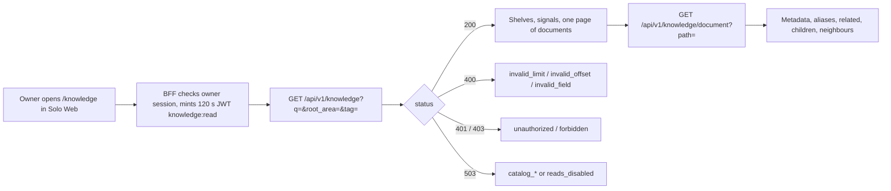
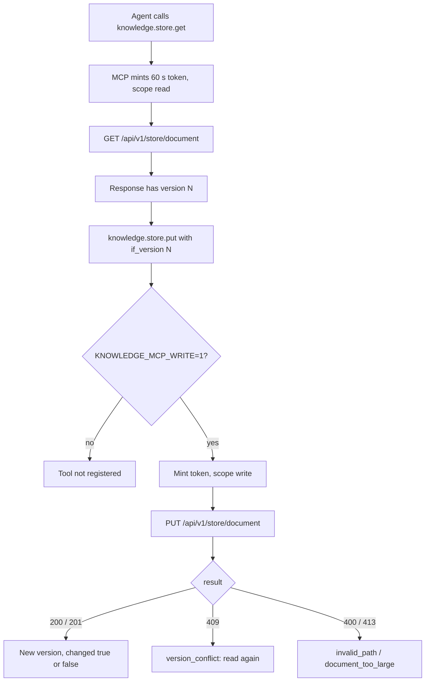
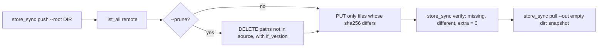

# 03 — User flows

repo นี้เป็น API ไม่มีหน้าจอ; "user flow" คือ journey ของแต่ละ caller ผ่าน route จริงใน `server.py`

## Owner ค้นเอกสารผ่าน Solo Web /knowledge

## Agent อ่าน/เขียนผ่าน knowledge MCP

## Owner ย้ายหรือสำรอง directory ด้วย store_sync

Sources: `server.py` (`_overview`, `_detail`, `_store_route`), `contracts/knowledge.v1.md`, `knowledge_mcp.py` (`build_server`, `mint`, `TOKEN_LIFETIME`, `main`), `scripts/store_sync.py` (`push`, `verify`, `pull`), `PRODUCT.md`, `README.md`

## Open questions

- หน้า Solo Web /knowledge และ Knowledge Hub /private อยู่คนละ repo (life-dashboard-web, content-knowledgehub-web) จึงไม่ได้วาดหน้าจอที่นี่
