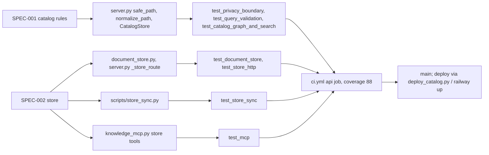

# 04 — Traceability (RTM)

Requirement มาจาก `specs/001-l2-baseline/spec.md` (AC-01..AC-11) และ `specs/002-document-store/spec.md` (AC-01..AC-13); release = commit บน `main` + CI `ci.yml` (ไม่มี tag/release) และ deploy แบบ manual (`deploy_catalog.py`)

| Req | Requirement | Code | Test | Release |
|---|---|---|---|---|
| S1 AC-01 | secret/raw/private/non-md paths never served | `server.py` `safe_path` | `tests/test_privacy_boundary.py::test_secret_raw_private_and_non_markdown_paths_are_never_served` | `6560718` |
| S1 AC-02 | unsafe records dropped and counted | `server.py` `CatalogStore._load` | `test_privacy_boundary.py::test_unsafe_records_are_dropped_and_counted_as_excluded` | `6560718` |
| S1 AC-03 | canonical URL / URI aliases never leave | `server.py` `safe_alias` | `test_privacy_boundary.py::test_canonical_urls_and_unsafe_aliases_never_leave_the_service` | `6560718` |
| S1 AC-04 | paging bounds | `server.py` `parse_limit`, `parse_offset` | `test_query_validation.py::test_a_limit_outside_1_to_100_or_not_an_integer_is_invalid_limit` | `6560718` |
| S1 AC-05 | traversing/absolute paths invalid | `server.py` `normalize_path` | `test_query_validation.py::test_absolute_traversing_empty_or_oversized_paths_are_invalid` | `6560718` |
| S1 AC-06 | stable 400 codes | `server.py` `bounded_text`, `_detail` | `test_query_validation.py::test_bad_query_parameters_are_a_400_with_a_stable_code` | `6560718` |
| S1 AC-07 | references resolve only in catalog | `server.py` `resolve_reference` | `test_catalog_graph_and_search.py::test_references_resolve_only_to_paths_in_the_catalog` | `6560718` |
| S1 AC-08 | document graph | `server.py` `_detail`, `_overview` | `test_catalog_graph_and_search.py::test_parent_related_and_children_form_the_document_graph` | `6560718` |
| S1 AC-09 | search ranking | `server.py` `_score`, `_overview` | `test_catalog_graph_and_search.py::test_search_ranks_title_matches_above_path_tag_and_description` | `6560718` |
| S1 AC-10 | unsupported catalog fails closed | `server.py` `CatalogStore._load` | `test_catalog_graph_and_search.py::test_an_unsupported_catalog_is_a_503_not_a_partial_list` | `6560718` |
| S1 AC-11 | catalog over 20 MiB refused | `server.py` `CatalogStore._load` | `test_catalog_graph_and_search.py::test_a_catalog_over_20_mib_is_refused_before_it_is_read` | `6560718` |
| S2 AC-01 | exact-byte round trip | `document_store.py` `put`, `get` | `tests/test_document_store.py::test_a_document_round_trips_with_its_exact_bytes` | `4d40219` |
| S2 AC-02 | binary as base64 | `document_store.py` `is_text`, `Document.to_payload` | `test_document_store.py::test_binary_files_round_trip_as_base64` | `4d40219` |
| S2 AC-03 | history kept on write/delete | `document_store.py` `store_versions` | `test_document_store.py::test_every_write_and_delete_keeps_history` | `4d40219` |
| S2 AC-04 | stale if_version → 409 | `document_store.py` `conflict` | `test_document_store.py::test_a_stale_if_version_is_a_409` | `4d40219` |
| S2 AC-05 | identical write no-op | `document_store.py` `put` | `test_document_store.py::test_an_identical_write_does_not_add_a_version` | `4d40219` |
| S2 AC-06 | unsafe paths / unknown space refused | `document_store.py` `check_path`, `_Spaces.check_space` | `test_document_store.py::test_unsafe_paths_and_unknown_spaces_are_refused` | `4d40219`, `0b735a0`, `797a53b` |
| S2 AC-07 | 10 MiB / 16 MiB limits | `document_store.py` `check_write`, `server.py` `_read_body` | `test_document_store.py::test_oversized_documents_are_a_413`, `test_store_http.py::test_http_transport_reads_the_request_body_within_limits` | `d47dea0` |
| S2 AC-08 | list by prefix, metadata only | `document_store.py` `list` | `test_document_store.py::test_listing_by_prefix_returns_metadata_only`, `test_keyset_paging_survives_writes_between_pages` | `4d40219`, `38f971a` |
| S2 AC-09 | write scope separate | `server.py` `write_policy`, `preauthorize` | `test_store_http.py::test_writes_need_the_write_scope_and_reads_the_read_scope`, `test_an_unauthorized_write_is_refused_before_the_body_is_read` | `4d40219`, `91c8d00` |
| S2 AC-10 | no DB → 503 store_unavailable | `server.py` `store_from_env`, `_store_route` | `test_store_http.py::test_without_a_database_the_store_is_a_503` | `4d40219` |
| S2 AC-11 | push skips unchanged, verify parity | `scripts/store_sync.py` `push`, `verify` | `tests/test_store_sync.py::test_push_skips_unchanged_files_and_verify_proves_parity` | `4d40219` |
| S2 AC-12 | pull stays inside target | `scripts/store_sync.py` `pull`, `safe_target` | `test_store_sync.py::test_pull_writes_each_document_inside_the_target` | `4d40219` |
| S2 AC-13 | MCP store tools, own scope | `knowledge_mcp.py` store tools | `tests/test_mcp.py::test_store_tools_call_the_api_with_their_own_scope` | `4d40219`, `c717981` |
| ops | catalog deploy verified by revision | `scripts/deploy_catalog.py` | `tests/test_deploy_catalog.py` (VerifyTest, MainTest) | `ee33256` |

Sources: `specs/001-l2-baseline/spec.md`, `specs/002-document-store/spec.md`, `server.py`, `document_store.py`, `scripts/store_sync.py`, `scripts/deploy_catalog.py`, `knowledge_mcp.py`, `tests/*.py`, `.github/workflows/ci.yml`, `git log origin/main`

## Open questions

- SPEC-001 ยัง "in review, owner approval pending" และ review 2026-10-24 ขอแก้ (§4 table เสีย, AC-11 ควร assert code): ยังไม่ปิด
- `--prune` (`1f0f62f`) และ symlink refusal (`ab053c9`) ไม่มี AC ใน SPEC-002 แม้มี test (`test_push_with_prune_mirrors_deletes_and_renames`)
- "release" ของ commit ใดถึง production จริงไม่ได้บันทึก (ไม่มี tag; deploy เป็น `railway up` จากเครื่อง)
