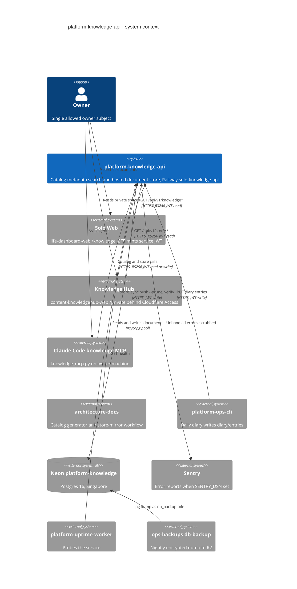

# 05 — C4 Context

Sources: `PRODUCT.md`, `README.md`, `server.py`, `document_store.py`, `knowledge_mcp.py`, `_sentry.py`, `scripts/store_sync.py`, architecture-docs `.github/workflows/store-mirror.yml`, ops record: knowledge-api-hosted (2026-11-03), ops record: hosted-document-store (2026-11-03), ops record: prod-baseline-monitoring-backups (2026-11-03)

ภาพรวมระบบกลางอยู่ที่ [architecture-docs C4-DIAGRAMS.md](https://github.com/bookchaowalit/architecture-docs/blob/main/docs/architecture/C4-DIAGRAMS.md) (ยังไม่มี node ของ knowledge-api โดยตรง)

## Open questions

- Solo Web ที่เรียก API: PRODUCT.md ระบุ `bookchaowalit/life-dashboard-web`, ops record ระบุ private key อยู่บน Vercel `owner-web` และ issuer `solo-web-one.vercel.app`: ยืนยันว่าเป็นตัวเดียวกัน
- uptime worker probe `/health` หรือ `/ready`: PRODUCT.md บอกแค่ target `knowledge-api`
