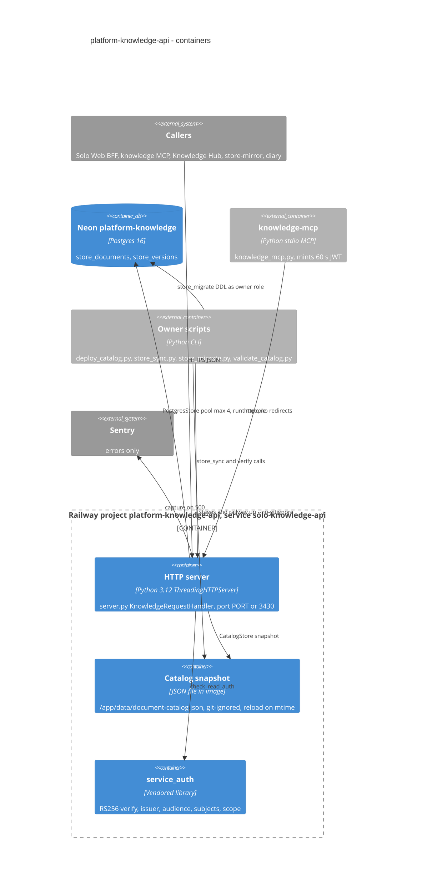

# 06 — C4 Container

Sources: `Dockerfile`, `.railway/railway.ts`, `.railway/railway.ts`, `server.py` (`main`, `KnowledgeRequestHandler`, `CatalogStore`, `store_from_env`), `document_store.py` (`PostgresStore.__init__`), `vendor/service-auth/service_auth/__init__.py`, `knowledge_mcp.py`, `scripts/*.py`, `_sentry.py`, `pyproject.toml`

## Open questions

- ไม่มี

