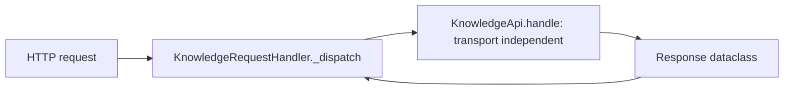

# ADR-0001 — Python stdlib HTTP server, no web framework

- Status: accepted (retro-documented)
- Date: retro-documented 2026-11-04 (behaviour present since `d845ec9`, 2026-10-12)

## Context

service ต้องเล็ก เปิด route ไม่กี่ตัว (`/health`, `/ready`, 2 catalog routes, 3 store routes) และควบคุม header/body ได้ละเอียด (authorize ก่อนอ่าน body, ไม่ log request)

## Decision

ใช้ `http.server.ThreadingHTTPServer` + `BaseHTTPRequestHandler` ของ stdlib; routing ทำเองใน `KnowledgeApi.handle` ที่ไม่ผูกกับ transport (test เรียกตรงได้); dependency runtime มีแค่ `solo-empire-service-auth`, `sentry-sdk`, `psycopg[binary,pool]`

## Evidence

- `server.py` (`KnowledgeRequestHandler`, `log_message` returns nothing, `KnowledgeApi.handle`, `main`)
- `pyproject.toml` `[project] dependencies`
- `DOCPACK/00-product-card.md` "Stack: Python (stdlib server)"

## Consequences

- ไม่มี middleware/async; concurrency = thread ต่อ request; body limit และ `Transfer-Encoding` ต้องเขียนเอง (`_read_body`)
- request logging ปิด (ไม่มี access log ให้ตรวจ incident)

Sources: `server.py`, `pyproject.toml`, `DOCPACK/00-product-card.md`
