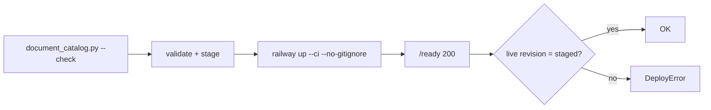

# ADR-0002 — Railway serverless, manual deploy with a git-ignored catalog

- Status: accepted (retro-documented)
- Date: retro-documented 2026-11-04 (deploy script `ee33256`, 2026-11-02)

## Context

catalog จริง (`data/document-catalog.json`) เป็น metadata ส่วนตัวของ owner จึงอยู่ใน `.gitignore`; แต่ `Dockerfile` COPY ไฟล์นี้เข้า image ดังนั้น Railway git deploy build ไม่ได้ (ops record: deploy 10-18 FAILED ด้วยเหตุนี้)

## Decision

- host บน Railway project `platform-knowledge-api` service `solo-knowledge-api`, `sleepApplication: true` (serverless), region Singapore
- ไม่ต่อ CD: deploy ด้วย `scripts/deploy_catalog.py` = generator freshness check → validate + stage atomically → `railway up --ci --no-gitignore` → รอ `/ready` 200 → เทียบ live `catalog.revision` กับ sha256 ของ snapshot
- `.railwayignore` กันไฟล์อื่นที่ git ignore ไม่ให้ขึ้นไป

## Evidence

`Dockerfile`, `.gitignore`, `.railwayignore`, `.railway/railway.ts`, `.railway/railway.ts`, `scripts/deploy_catalog.py`, `tests/test_deploy_catalog.py`, `README.md` (Deploy), ops record: knowledge-api-hosted (2026-11-03), ops record: hosted-shared-services (2026-11-03) "Not on CD: platform-knowledge-api"

## Consequences

- push เข้า `main` ไม่ deploy: โค้ดใหม่ (เช่น store fix) ถึง production เมื่อ owner รัน deploy เท่านั้น
- ต้อง deploy แบบ `--federated` ไม่งั้น source เสริมหาย (ops record)
- live deploy เคยถูก REMOVED (2026-10-29) โดยไม่ทราบสาเหตุ และไม่มี CD มาแทน

Sources: ไฟล์ข้างต้น
