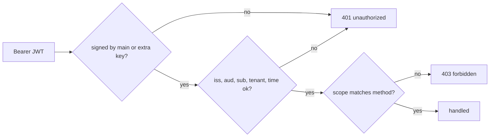

# ADR-0003 — Owner-only RS256 service JWT with separate read and write scopes

- Status: accepted (retro-documented)
- Date: retro-documented 2026-11-04 (extra key `4e91355` 2026-11-02, several extra keys `ce55770` 2026-11-03, write scope `4d40219` 2026-11-03)

## Context

ข้อมูลเป็นของ owner คนเดียว; caller หลายตัว (Solo Web BFF, MCP, Knowledge Hub, sync job) ต้องไม่ใช้ key ร่วมกัน

## Decision

- ทุก `/api/v1/*` ต้องมี RS256 JWT: `iss` = Solo Web origin, `aud=knowledge-api`, `tenant_id=owner`, `sub` ใน `KNOWLEDGE_API_AUTH_SUBJECTS`, อายุ ≤ 120 s, ต้องมี `iat/nbf/exp/jti`; ห้าม remote key header
- trust `KNOWLEDGE_API_AUTH_PUBLIC_KEY` + PEM หลาย block ใน `KNOWLEDGE_API_AUTH_EXTRA_PUBLIC_KEY`; extra key ใช้แทน main key ไม่ได้; key เสีย = fail closed
- policy แยก: `knowledge:read` สำหรับ GET, `knowledge:write` สำหรับ PUT/DELETE; ตรวจก่อนอ่าน body
- static token เฉพาะ development; host non-loopback บังคับ production

## Evidence

`vendor/service-auth/service_auth/__init__.py`, `vendor/service-auth/tests/test_auth.py`, `server.py` (`auth_policy`, `write_policy`, `preauthorize`, `main`), `tests/test_store_http.py`, `tests/test_server.py`, `README.md` (Scoped authorization), `knowledge_mcp.py` (`mint`)

## Consequences

- การ revoke caller = เอา PEM block ของมันออกแล้ว restart; ไม่มี per-caller audit ใน API
- gateway กลางไม่ trust issuer นี้ จึงเรียกตรง (ops record: api-gateway-edge, 2026-11-03)

Sources: ไฟล์ข้างต้น
