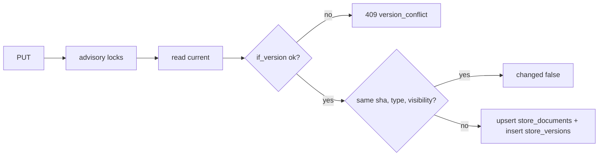

# ADR-0004 — Document bodies in Postgres bytea with full version history

- Status: accepted (retro-documented; scope approved by owner 2026-11-03 in SPEC-002)
- Date: 2026-11-03 (`4d40219`)

## Context

owner ตัดสินใจย้าย content ออกจาก Git; knowledge-base ราว 24 MB

## Decision

- Postgres (Neon project แยก `platform-knowledge`) ตาราง `store_documents` (ปัจจุบัน) + `store_versions` (ทุก version รวม delete) เก็บ body เป็น `bytea`
- write ทุกครั้ง = version ใหม่ใน transaction เดียว; `if_version` optimistic concurrency; identical write = no-op
- `pg_advisory_xact_lock` ต่อ path และทุก parent path กัน file/folder clash race
- service ไม่รัน DDL; `scripts/store_migrate.py` ใช้ owner role และ GRANT แค่ DML ให้ runtime role
- store ไม่ gate readiness (`store`: `disabled`, `checking`, `available`, `unavailable`)

## Evidence

`document_store.py` (`SCHEMA_SQL`, `PostgresStore`), `scripts/store_migrate.py`, `specs/002-document-store/spec.md` §4, `tests/test_document_store.py`, `README.md` (Document store), ops record: hosted-document-store (2026-11-03)

## Consequences

- backup/restore ทางเดียวกับ DB อื่น (db-backup); media ใหญ่ไป R2 เป็น option ภายหลัง (spec)
- history ไม่มีการลบ/retention: โตไม่จำกัด

Sources: ไฟล์ข้างต้น
