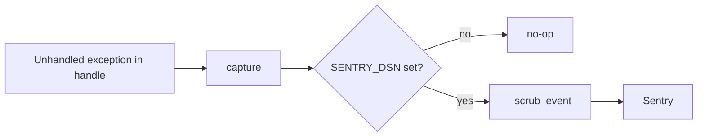

# ADR-0005 — Sentry errors only, scrubbed, opt-in by SENTRY_DSN

- Status: accepted (retro-documented)
- Date: 2026-10-18 (`d86b7ce` PR #2, `79fcdc5` PR #3)

## Decision

`_sentry.py` init เมื่อมี `SENTRY_DSN`: `traces_sample_rate=None`, `send_default_pii=False`, LoggingIntegration ปิด, `before_send=_scrub_event` ลบ request detail/extra และ scrub URL password, token, JWT; `capture()` เรียกเฉพาะ 500 ใน `KnowledgeApi.handle`

## Evidence

`_sentry.py`, `server.py` (`init_sentry()` at import, `capture(exc)`), `tests/test_sentry.py`, ops record: prod-baseline-monitoring-backups (2026-11-03) Sentry pattern

Sources: ไฟล์ข้างต้น
