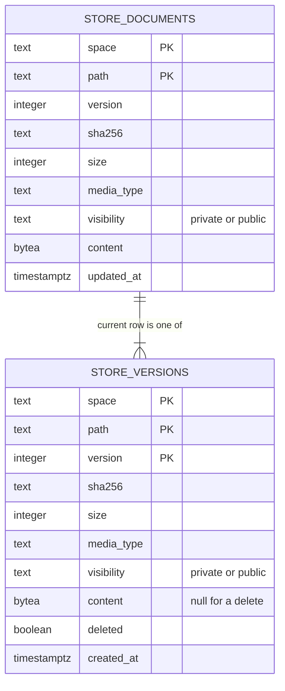
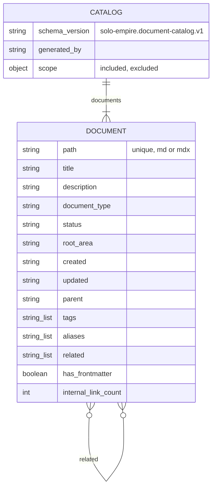

# 09 — ERD

ข้อมูลที่ persist มีสองแบบ: (1) ตาราง Postgres ของ document store (SPEC-002) และ (2) ไฟล์ catalog JSON (`solo-empire.document-catalog.v1`) ที่อ่านอย่างเดียว

## Document store (Postgres, `document_store.py` `SCHEMA_SQL`)

ไม่มี foreign key จริงในฐานข้อมูล: ความสัมพันธ์คือ `(space, path)` เดียวกัน และ `store_documents.version` = version ล่าสุดที่ไม่ใช่ delete; เมื่อ delete แถวใน `store_documents` ถูกลบและเพิ่มแถว `deleted=true` ใน `store_versions`

Roles (ops record + `scripts/store_migrate.py`): `knowledge_owner` (DDL), `knowledge_runtime` (SELECT/INSERT/UPDATE/DELETE บนสองตาราง), `db_backup` (SELECT)

## Catalog file (read-only JSON)

Sources: `document_store.py` (`SCHEMA_SQL`, `PostgresStore.put`, `delete`), `scripts/store_migrate.py`, `server.py` (`CATALOG_SCHEMA_VERSION`, `CatalogStore._load`), `contracts/knowledge.v1.md` (Document summary fields), `scripts/validate_catalog.py`, `data/document-catalog.example.json`, `specs/002-document-store/spec.md` §4, ops record: hosted-document-store (2026-11-03)

## Open questions

- ไม่มี index เพิ่มนอกจาก primary key: list ด้วย `prefix` ใช้ `starts_with(path, ...)` บน PK; พอหรือไม่เมื่อ space โต
- ไม่มี retention ของ `store_versions`
