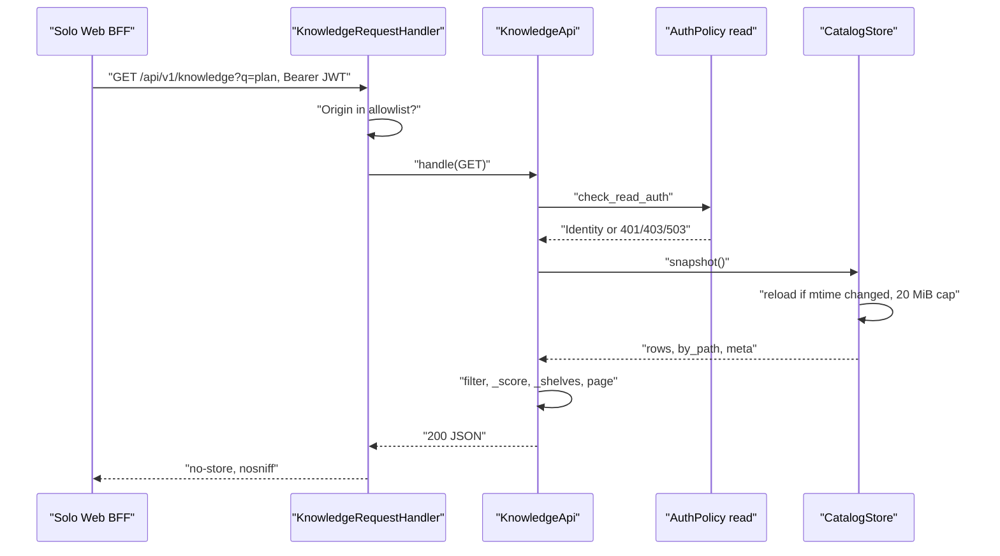
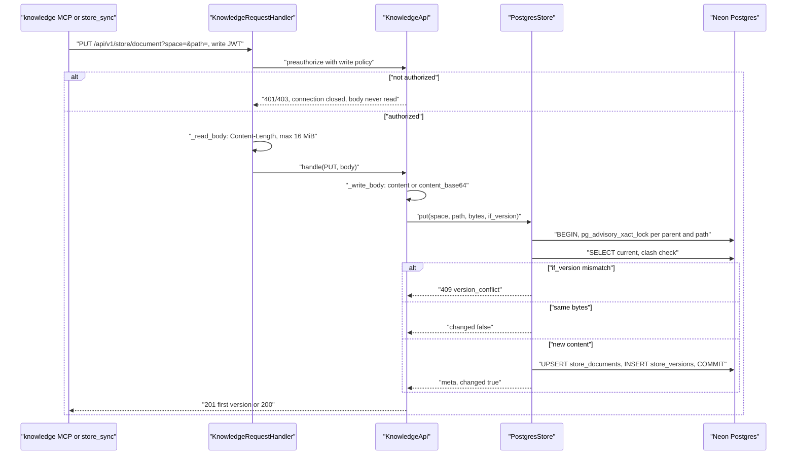
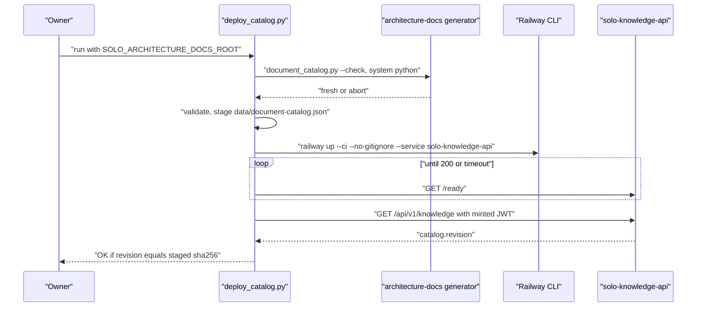
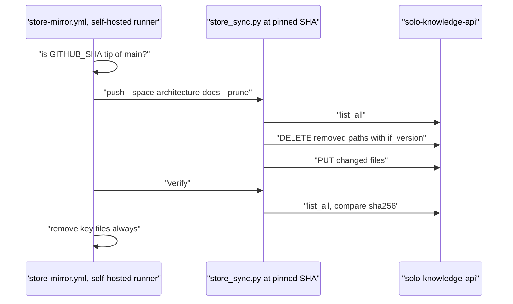

# 10 — Sequences

## A. Solo Web search (catalog)

## B. Store write (PUT)

## C. Catalog deploy and verify

## D. store-mirror from architecture-docs

Sources: `server.py` (`_dispatch`, `preauthorize`, `_read_body`, `handle`, `_overview`, `_store_route`), `document_store.py` (`PostgresStore.put`, `_lock_path`), `scripts/deploy_catalog.py` (`check_fresh`, `stage`, `railway_up`, `verify`), `scripts/store_sync.py` (`push`, `verify`), architecture-docs `.github/workflows/store-mirror.yml`

## Open questions

- store-mirror pin `ab053c9` แต่ main ล่าสุดคือ `797a53b`: ops record บอกให้ bump SHA เมื่อ store_sync เปลี่ยน (`797a53b` แก้ `document_store.py` ที่ store_sync import)
