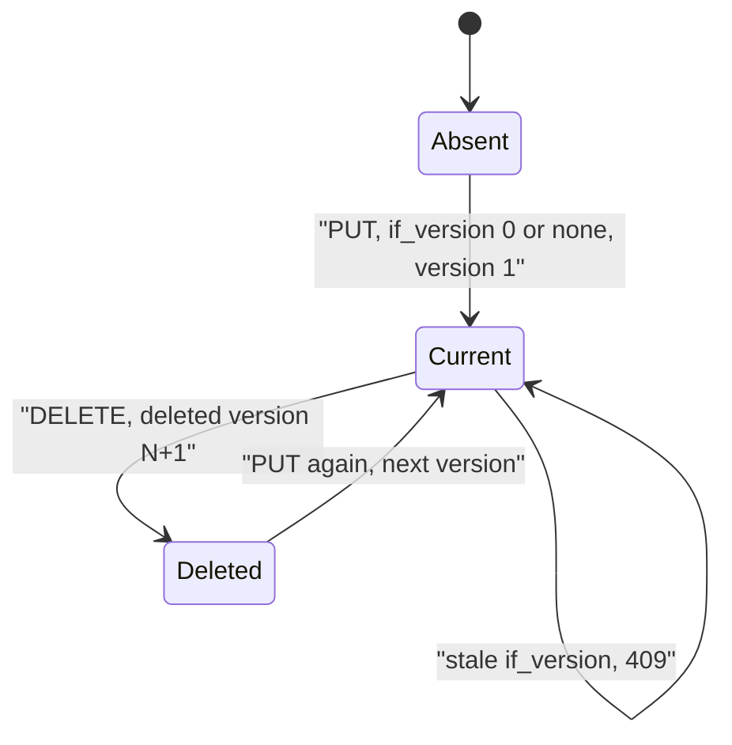
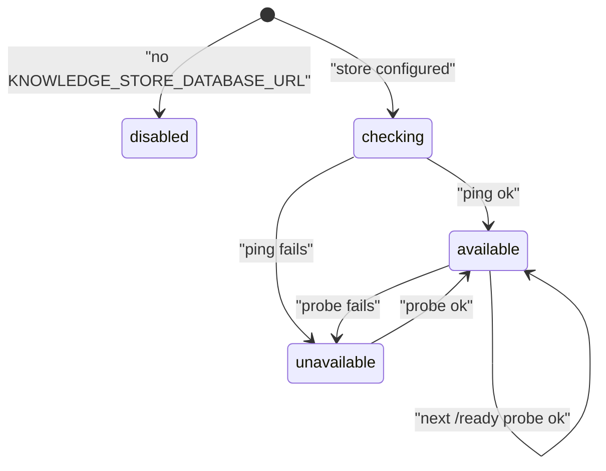
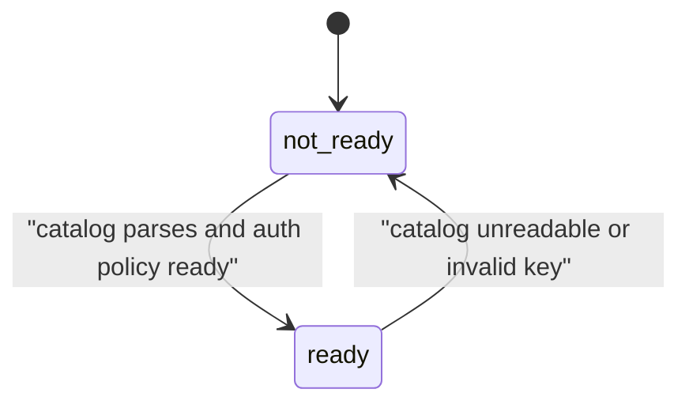

# 11 — State machines

## Stored document (per space + path)

## Store readiness probe (`_store_status`)

## Service readiness (`readiness`)

Catalog document `status` เป็น string อิสระจาก catalog (default `unclassified`) ไม่ใช่ lifecycle ในโค้ด จึงไม่วาด

Sources: `document_store.py` (`put`, `delete`, `conflict`), `server.py` (`_store_status`, `_ready`), `vendor/service-auth/service_auth/__init__.py` (`readiness`), `tests/test_document_store.py::test_every_write_and_delete_keeps_history`

## Open questions

- `visibility` private → public ทำได้ผ่าน API ด้วย write token แต่ MCP ห้าม: ใครคือ "owner step" ที่ publish (ไม่มีเครื่องมือใน repo)
