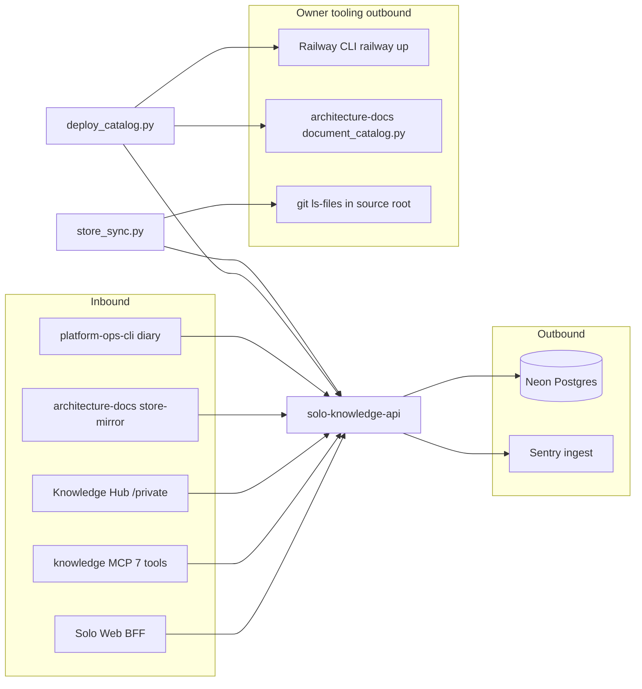

# 12 — API and integrations

สัญญา catalog: [contracts/knowledge.v1.md](../../contracts/knowledge.v1.md) + [JSON Schema](../../contracts/knowledge.v1.json) (reused); store routes: [README Document store](../../README.md#document-store-spec-002)

| Method | Path | Auth | Purpose | Main errors |
|---|---|---|---|---|
| GET | `/health` | public | liveness | — |
| GET | `/ready` | public | catalog + auth readiness, `store` reported | 503 not_ready |
| GET | `/api/v1/knowledge` | `knowledge:read` | overview, search, filters, page | 400 invalid_limit/offset/field, 503 catalog_* |
| GET | `/api/v1/knowledge/document?path=` | `knowledge:read` | one document metadata + neighbours | 400 invalid_path / missing_path, 404 |
| GET | `/api/v1/store/documents?space=&prefix=&limit=&offset=&after=` | `knowledge:read` | list metadata | 404 unknown_space |
| GET | `/api/v1/store/document?space=&path=[&version=]` | `knowledge:read` | content or content_base64 | 404 not_found |
| GET | `/api/v1/store/history?space=&path=` | `knowledge:read` | all versions | 404 |
| PUT | `/api/v1/store/document?space=&path=` | `knowledge:write` | create/update | 409 version_conflict, 413, 411, 400 |
| DELETE | `/api/v1/store/document?space=&path=[&if_version=]` | `knowledge:write` | delete, history kept | 404, 409 |
| OPTIONS | any | none | CORS preflight, 204 | — |

MCP tool → route: `knowledge.search` → GET `/api/v1/knowledge`; `knowledge.document.get` → GET `/knowledge/document`; `knowledge.store.list|get|history` → GET store routes; `knowledge.store.put` / `.delete` → PUT / DELETE (เฉพาะ `KNOWLEDGE_MCP_WRITE=1`)

ไม่มี webhook, ไม่มี third-party SDK อื่นนอกจาก `sentry-sdk`, `psycopg`, และฝั่ง MCP/script: `httpx`, `mcp`, `PyJWT`/`cryptography`

Sources: `server.py` (`_store_route`, `handle`, `_write`), `knowledge_mcp.py` (`build_server`, `main`), `scripts/store_sync.py`, `scripts/deploy_catalog.py`, `contracts/knowledge.v1.md`, `README.md`, `pyproject.toml`, `uv.lock`, ops record: hosted-document-store (2026-11-03)

## Open questions

- `contracts/knowledge.v1.md` ยังเขียนว่า "GET and OPTIONS only" และ 405 mutation: ล้าสมัยหลัง SPEC-002 (store มี PUT/DELETE); ไม่มี contract ไฟล์ของ store routes
- CORS default `http://localhost:3300,http://localhost:3000`: production ตั้ง `KNOWLEDGE_API_CORS_ORIGINS` ไว้อย่างไร (ไม่อยู่ใน repo)
