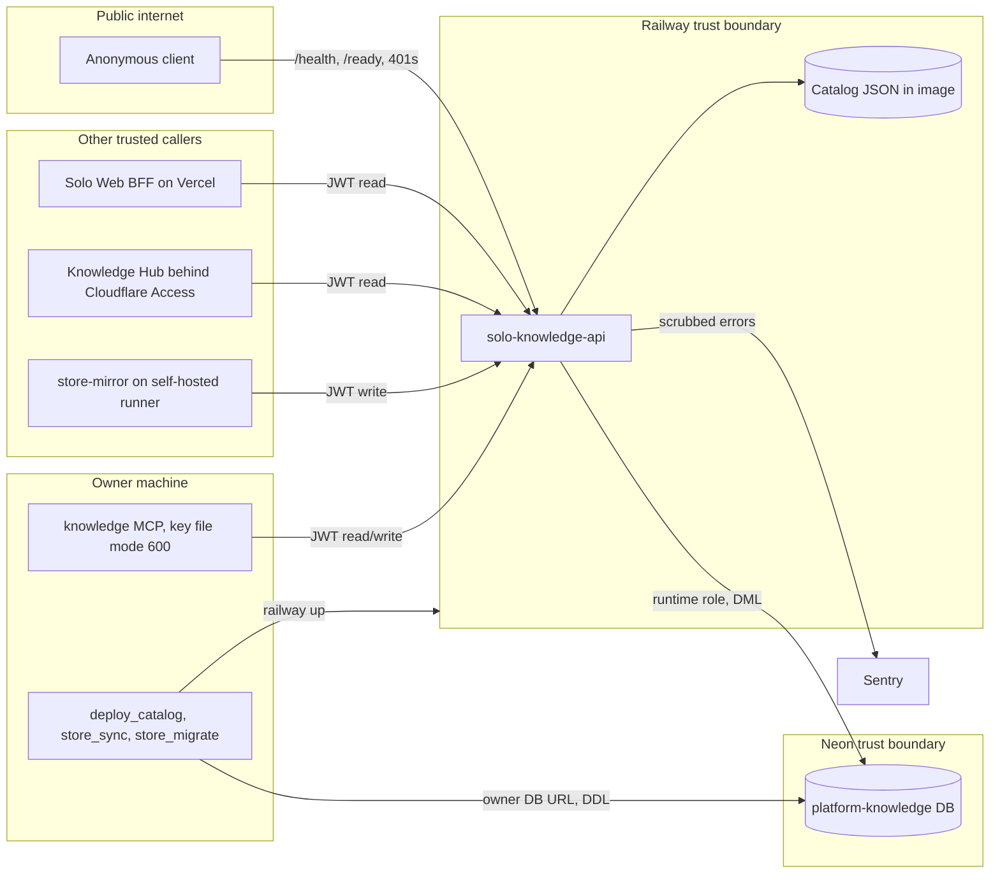

# 13 — Threat model

| Element | STRIDE | Threat | Mitigation in code | Gap |
|---|---|---|---|---|
| API auth | S | forged token | RS256 with local keys only, remote key headers rejected, iss/aud/sub/tenant/jti/time checks, ≤ 120 s (`service_auth`) | no per-caller identity: any trusted key = owner |
| API auth | E | read token used to write | separate `knowledge:write` policy, checked before body read (`preauthorize`) | — |
| API | D | large or slow uploads | 16 MiB request / 10 MiB document caps, `Transfer-Encoding` refused (411), unauth body never read | no rate limit; ThreadingHTTPServer unbounded threads |
| API | I | leaking secret paths or bodies via catalog | `safe_path` drops `.git`, `.ssh`, `.env*`, secrets, private, raw data, diary, clients; `canonical` null; no bodies in catalog routes | — |
| Store | T | writing secret-like files | `check_path` refuses `.git/ .ssh/ .gnupg/ .aws/`, `.env*`, `*.pem *.key *.p12 *.pfx`, traversal, NUL, backslash, 255-byte names | — |
| Store | T | lost update | `if_version` + advisory locks + history in one transaction | — |
| Store | R | who wrote a version | `store_versions.created_at` only | no actor/subject stored per version; no request log (`log_message` disabled) |
| Store | I | public visibility by agent | MCP `StorePut.visibility` is `Literal["private"]` | API itself accepts `public` from any write token |
| DB | E | service runs DDL | runtime role DML only (`store_migrate.py`), service never migrates | — |
| Browser | S | cross-origin calls | exact Origin allowlist else 403; `no-store`, `nosniff` | — |
| Sentry | I | PII in errors | `send_default_pii=False`, `_scrub_event`, no tracing | — |
| MCP | I | key theft on owner machine | key file must be mode 600 (`read_owner_file`), token never printed, no redirects followed | key holder can read and (if enabled) write everything |
| Deploy | T | wrong catalog deployed | freshness check, validation, live revision = staged sha256 | deploy runs from a laptop, no audit trail beyond Railway |
| store_sync pull | T | path escape on disk | `safe_target`, empty `--out` required, symlinked folders refused on push | — |

Sources: `server.py`, `document_store.py`, `vendor/service-auth/service_auth/__init__.py`, `knowledge_mcp.py`, `scripts/store_migrate.py`, `scripts/store_sync.py`, `scripts/deploy_catalog.py`, `_sentry.py`, `tests/test_privacy_boundary.py`, `tests/test_store_http.py`, `tests/test_mcp.py`, architecture-docs `.github/workflows/store-mirror.yml`, ops record: hosted-document-store (2026-11-03)

## Open questions

- ต้องการบันทึก JWT `sub`/key id ต่อ version (repudiation) หรือไม่
- ต้องการ rate limit หรือพึ่ง Railway/edge (service นี้ไม่ผ่าน gateway.bookchaowalit.com ตาม ops record api-gateway-edge)
