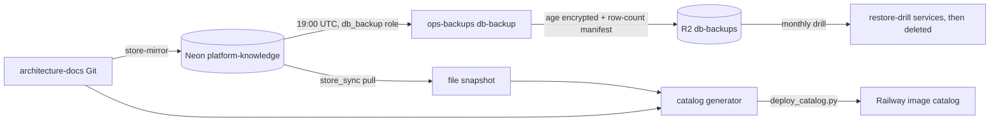

# 14 — Backup and DR

| Data | Lives in | Source of truth | Backup | Restore path |
|---|---|---|---|---|
| Store documents + history | Neon `platform-knowledge` (Singapore, pg16, db `knowledge`) | this store (knowledge-base archived 2026-11-03) | nightly age-encrypted dump by `ops-backups/db-backup` target `knowledge` to R2 `db-backups` (14/56/365 days); Neon history | db-backup runbook restore drill; `store_sync pull` gives a file snapshot |
| Space `architecture-docs` | same DB | architecture-docs Git (one-way mirror) | Git itself | re-run store-mirror (`push --prune` + `verify`) |
| Catalog JSON | inside Railway image | regenerated from architecture-docs + store snapshot | none needed (derived) | rebuild `--federated` and `deploy_catalog.py` |
| Secrets/keys | Railway variables, Infisical | Infisical | Infisical | re-set variables, restart |

RTO / RPO: **not defined** in the repo or specs. SPEC-002 NFR states only "nightly age-encrypted backup to R2 + Neon history"; implied RPO ≤ 24 h for store data

Sources: `specs/002-document-store/spec.md` §5, §7, `scripts/store_sync.py` (`pull`), `scripts/deploy_catalog.py`, `README.md`, ops record: hosted-document-store (2026-11-03), ops record: prod-baseline-monitoring-backups (2026-11-03), ops record: knowledge-api-hosted (2026-11-03)

## Open questions

- first nightly backup ของ target `knowledge` (due 2026-11-03 19:00 UTC) ยัง unverified ตาม ops record
- restore drill รายเดือนรวม DB นี้หรือยัง
- ไฟล์ `cert.pem` ใน knowledge-base ที่ store ปฏิเสธ และ resume 3 ไฟล์ที่ไม่ได้ import: อยู่แค่ใน repo ที่ archive แล้ว/เครื่อง owner
- ตั้ง RTO/RPO เป็นตัวเลข
