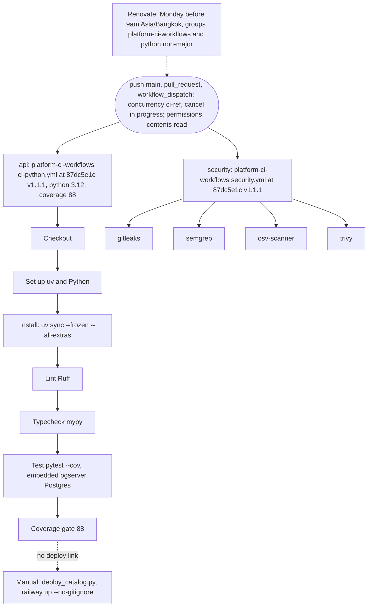

# 15 — CI/CD pipeline

workflow เดียว `.github/workflows/ci.yml`; ไม่มี deploy job (ไม่ได้ต่อ CD, ดู ADR-0002)

Sources: `.github/workflows/ci.yml`, `bookchaowalit/platform-ci-workflows` `.github/workflows/ci-python.yml` and `security.yml` at `87dc5e1c` (step names via `gh api`), `pyproject.toml` (dev deps `pgserver`), `specs/002-document-store/spec.md` §6, `renovate.json`, `scripts/deploy_catalog.py`

ภายนอก repo แต่ใช้โค้ด repo นี้: architecture-docs `store-mirror.yml` checkout repo นี้ที่ SHA pin `ab053c9` แล้วรัน `store_sync.py` (ดู 10-D)

## Open questions

- CI ไม่ build Docker image: Dockerfile พังจะรู้ตอน `railway up` เท่านั้น
- Renovate เปิด PR จริงหรือไม่ (`gh pr list` มีแค่ PR #1–#3 ของ owner)
