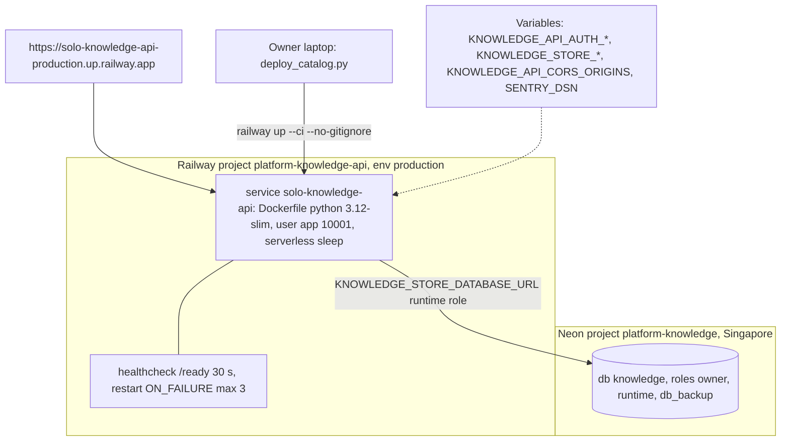

# 16 — Deployment

| Item | Value | Source |
|---|---|---|
| Region | asia-southeast1 (moved 2026-11-03) | ops record: hosted-document-store; `.railway/railway.ts` comment |
| Image | `python:3.12-slim` + uv 0.13.1, `uv sync --frozen --no-dev --no-editable`, catalog at `/app/data/document-catalog.json` | `Dockerfile` |
| Env in image | `KNOWLEDGE_API_HOST=0.0.0.0`, `KNOWLEDGE_API_ENV=production` | `Dockerfile` |
| Spaces | `KNOWLEDGE_STORE_SPACES=knowledge-base,architecture-docs` | ops record: hosted-document-store |
| Live catalog | federated, 1620 docs, revision `15edfbb7…` (2026-11-03) | ops record: knowledge-api-hosted |
| CD | none | ops record: hosted-shared-services; `README.md` |

Sources: `Dockerfile`, `railway.toml`, `.railway/railway.ts`, `.railwayignore`, `README.md`, `PRODUCT.md`, `service.yaml`, ops records knowledge-api-hosted, hosted-document-store, hosted-shared-services (2026-11-03)

## Open questions

- `service.yaml` ยังเขียน `deploy.target: unassigned`, `writes: []` และ README "Target assignment and live deployment remain pending": ล้าสมัย
- commit ใดของ main รันอยู่บน production ตอนนี้ (ดู Railway deployment list; เรียกไม่ได้ในงานนี้)
