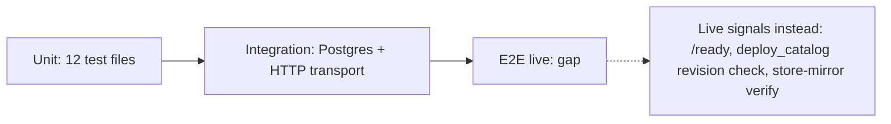

# 17 — Test coverage matrix

ทุก test รันใน CI job `api` (pytest, coverage gate 88%); store tests รันทั้ง `MemoryStore` และ Postgres จริง (embedded `pgserver` หรือ `KNOWLEDGE_STORE_TEST_DATABASE_URL`) ตาม fixture ใน `tests/test_document_store.py` (ไม่มีทั้งสองแบบ = skip) และ SPEC-002 §6 ไม่มี e2e กับ deployment จริง

| Feature | Unit | Integration (real Postgres / HTTP transport) | E2E (live) | Test files |
|---|---|---|---|---|
| Privacy boundary of catalog | yes | — | no | `test_privacy_boundary.py` |
| Query validation | yes | — | no | `test_query_validation.py` |
| Catalog graph, search, reload, limits | yes | — | no | `test_catalog_graph_and_search.py`, `test_server.py` |
| JWT auth, readiness, CORS, read-only transport | yes | HTTP server in-process | no | `test_server.py`, `vendor/service-auth/tests/test_auth.py` |
| Store contract: round trip, history, conflicts, limits, paging, locks | yes (memory) | yes (Postgres 16) | no | `test_document_store.py` |
| Store migration grants | — | yes (Postgres) | no | `test_document_store.py::test_migration_grants_the_runtime_role_data_access_only` |
| Store HTTP: scopes, body limits, preauthorize, extra keys | yes | HTTP transport | no | `test_store_http.py` |
| store_sync push / verify / pull / prune | yes (fake client) | — | no (store-mirror run is the live check) | `test_store_sync.py` |
| MCP tools and token minting | yes (fake transport) | verifier round trip | no | `test_mcp.py` |
| Catalog deploy script | yes (recorded subprocess and fetch) | — | no (script itself verifies live revision) | `test_deploy_catalog.py` |
| Catalog shape validator | yes | — | no | `test_validate_catalog.py` |
| Sentry init and scrub | yes | — | no | `test_sentry.py` |
| Docker image build | — | — | **gap** | none |

Sources: `tests/*.py` (function names), `tests/test_document_store.py` fixture, `tests/test_validate_catalog.py`, `vendor/service-auth/tests/test_auth.py`, `.github/workflows/ci.yml`, `specs/002-document-store/spec.md` §6, `pyproject.toml`

## Open questions

- coverage ที่วัดล่าสุด: SPEC-002 บันทึก 93% (local); CI gate ยัง 88 (ratchet จาก 90.78% 2026-10-22)
- `test_validate_catalog.py::test_local_snapshot_has_valid_shape` เป็น `skipUnless` ไฟล์ catalog จริง จึง skip ใน CI เสมอ
- ถ้า `pgserver` ติดตั้งไม่ได้ใน CI ครึ่ง Postgres จะ skip โดยไม่ fail: ยืนยันจาก log ของ CI run ว่ารันจริง
