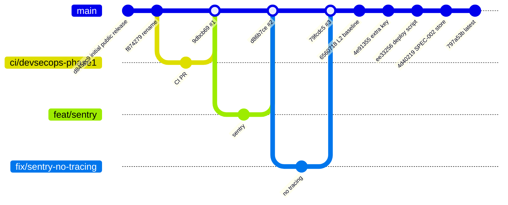
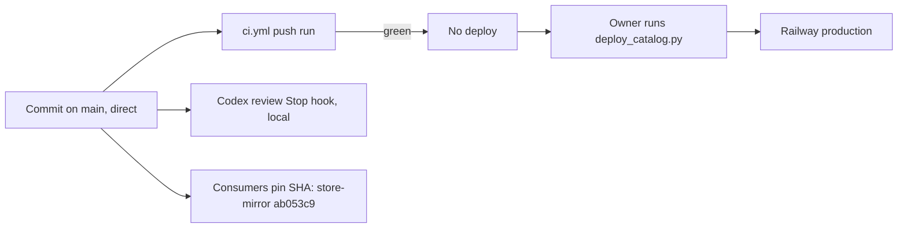

# 18 — Git and release workflow

สามช่วงจาก `git log --first-parent origin/main`: (1) 2026-10-12/13 import + rename (push ตรง), (2) 2026-10-17/18 PR #1–#3 (merge ผ่าน PR, squash), (3) ตั้งแต่ 2026-10-22 commit ตรงเข้า `main` (SPEC-001/002 "Main-only: yes", ADR-0004 rule 2)

Sources: `git log --first-parent origin/main`, `gh pr list -R bookchaowalit/platform-knowledge-api --state all`, `.github/workflows/ci.yml`, `specs/001-l2-baseline/spec.md`, `specs/002-document-store/spec.md`, `scripts/deploy_catalog.py`, architecture-docs `.github/workflows/store-mirror.yml`, ops record: codex-review-stop-hook (2026-11-03), ops record: hosted-document-store (2026-11-03, "Fixes from the Codex review (0b735a0)")

## Open questions

- ไม่มี branch protection / tag / release: ต้องการ tag ต่อ deploy เพื่อรู้ว่า production คือ SHA ใด หรือไม่
