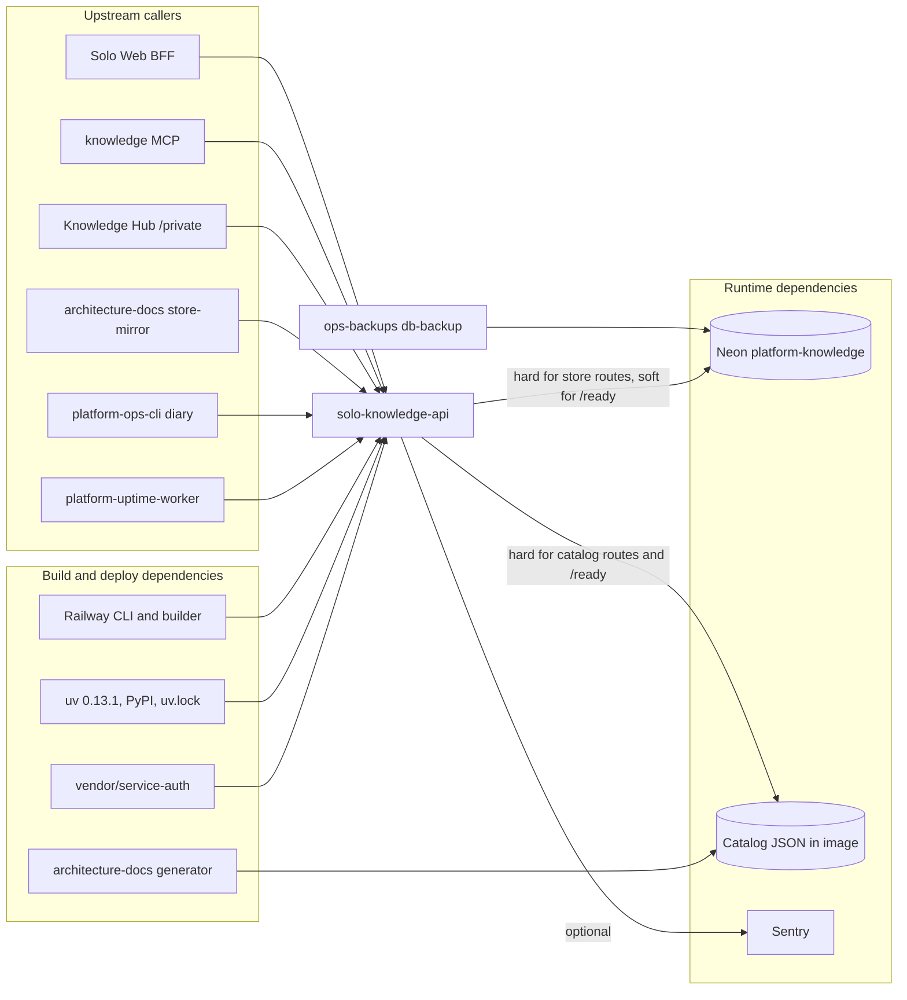

# 19 — Service dependency map

ไม่ผ่าน edge gateway: ops record api-gateway-edge (2026-11-03) ระบุว่า client ของ Knowledge sign ด้วย solo-web service key ซึ่ง gateway ไม่ trust จึงเรียกตรง

Sources: `server.py` (`store_from_env`, `_ready`, `CatalogStore`), `Dockerfile`, `pyproject.toml`, `scripts/deploy_catalog.py`, `PRODUCT.md`, architecture-docs `.github/workflows/store-mirror.yml`, ops records hosted-document-store, api-gateway-edge, prod-baseline-monitoring-backups (2026-11-03)

## Open questions

- Neon free compute quota เต็มต่อ project (ops record neon-platform-quota): DB นี้เป็น project ของตัวเอง แต่ไม่มี alert ใน repo ถ้า quota เต็ม
