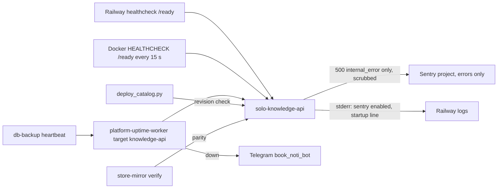

# 20 — Observability

| Signal | What it tells | Source |
|---|---|---|
| `/ready` `status`, `source`, `auth`, `store` | catalog parsed, auth valid, store probe | `server.py` `_ready`, `service_auth.readiness` |
| `catalog.revision` | which catalog is live | `server.py`, `scripts/deploy_catalog.py` |
| Sentry | unhandled 500 in `handle` | `_sentry.py`, `server.py` |
| Uptime probe | reachability | `PRODUCT.md` (Operating Context), ops record prod-baseline-monitoring-backups |
| store-mirror job result | parity of architecture-docs space | architecture-docs `store-mirror.yml` |
| Access log | **none**: `log_message` returns nothing (by design) | `server.py` |
| Metrics, tracing | **none**: `traces_sample_rate=None` | `_sentry.py` |

Measures ใน `PRODUCT.md`: catalog load failure (503 `catalog_*`, target 0), 5xx rate + uptime, catalog age `[ต้องยืนยัน]`

Sources: ตามตาราง

## Open questions

- 503 `catalog_*` และ 4xx ไม่ถูกส่ง Sentry และไม่มี log: จะวัด "catalog load failures" ใน PRODUCT.md จากอะไร
- ไม่มี heartbeat ของ catalog freshness หรือ store size
- ops record ระบุ live deploy ถูก REMOVED 2026-10-29 แล้วถึงแก้ 11-02: uptime ควรจับได้ แต่ไม่พบบันทึกการแจ้งเตือน
