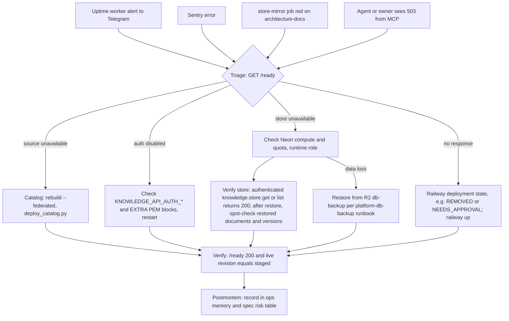

# 21 — Incident response

ไม่มี runbook เฉพาะใน repo; flow นี้ประกอบจาก alert channel ที่มีจริงและขั้นตอน deploy/verify ใน README

Sources: `README.md` (Deploy, Scoped authorization and readiness), `scripts/deploy_catalog.py`, `server.py` (`_ready`), `specs/002-document-store/spec.md` §7 risk 2, `PRODUCT.md`, ops records knowledge-api-hosted, prod-baseline-monitoring-backups, railway-deploy-approval-gate, neon-platform-quota (2026-11-03)

ตัวอย่างจริง: live deploy REMOVED 2026-10-29 17:12 UTC (สาเหตุไม่ทราบ) → redeploy 2026-11-02 (`8b92979`), verify ด้วย revision `a4af5b0e…` (ops record knowledge-api-hosted)

## Open questions

- ไม่มี postmortem template หรือ severity; root cause ของ 2026-10-29 ยังเปิดอยู่
- ใครได้ alert ถ้า Sentry ไม่ได้ตั้ง notification rule (ไม่อยู่ใน repo)
