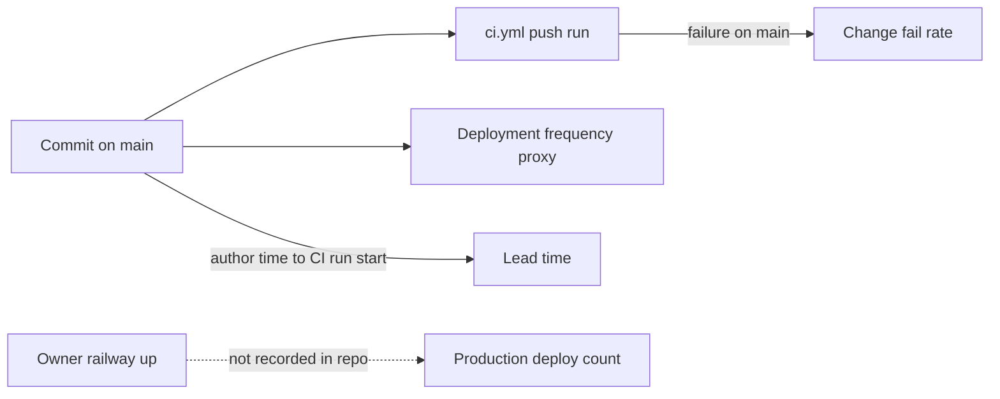

# 22 — DORA metrics

ช่วงวัด: 90 วัน **2026-08-06 → 2026-11-04** (วัด 2026-11-04 หลัง `git fetch`); repo มี history ตั้งแต่ `d845ec9` 2026-10-12 เท่านั้น (import แบบ squash) และ CI ตั้งแต่ 2026-10-17

**นิยาม deployment ของ repo นี้:** production deploy จริงคือ `railway up` แบบ manual (`deploy_catalog.py`) ซึ่งไม่ทิ้งร่องรอยใน git หรือ GitHub; จึงใช้ proxy = commit first-parent บน `main` (CI push run) และระบุว่า production deploy count วัดไม่ได้จาก repo

| Metric | How measured here | Value (90 days) | Command |
|---|---|---|---|
| Deployment frequency | first-parent commits on `origin/main` (proxy) | **29 commits on 8 days**; 19 of them on 2026-11-02/03 | `git log --first-parent --since=2026-08-06 --format='%ad' --date=short origin/main \| sort \| uniq -c` |
| Lead time for changes | commit author time → `createdAt` of the first `ci.yml` push run on `main` containing it (24 commits since CI exists) | **median 0 h, max 0.06 h** (`1e10e7d`); the 5 commits before CI (2026-10-12/13) are excluded | `gh run list -R bookchaowalit/platform-knowledge-api --limit 200 --json headSha,createdAt,headBranch,event` + `git log --format='%H %aI' <sha>` |
| Change fail rate | `ci.yml` push runs on `main` with `conclusion=failure` | **0 / 24 = 0 %** (23 success, 1 cancelled: `ce55770`, superseded by `d9cc91e` 20 s later); PR runs: 1 failure (`59b220d`, PR #1, fixed before merge) | `gh run list --workflow CI --json conclusion,headBranch,event` |
| Failed deployment recovery time | red `main` run → next green | **not computable**: no red run on `main`; production incident 2026-10-29 17:12 UTC (deploy REMOVED) → redeploy 2026-11-02 ≈ **4 days** (ops record knowledge-api-hosted, not from git) | — |
| Deployment rework rate | first-parent commits whose subject starts with `fix` or `Revert` | **15 / 29 = 51.7 %** (13 of them on 2026-11-02/03, mostly Codex review fixes of the same day) | `git log --first-parent --since=2026-08-06 --format='%h %s' origin/main \| grep -cE '^[0-9a-f]+ (fix\|revert\|Revert)'` |

Sources: `git log origin/main`, `gh run list -R bookchaowalit/platform-knowledge-api --limit 200` (31 runs), `gh pr list --state all` (3 PRs), `.github/workflows/ci.yml`, ops record: knowledge-api-hosted (2026-11-03)

## Caveats

- lead time ≈ 0 เพราะ commit ตรงเข้า `main` แล้ว push ทันที; ไม่ใช่เวลาทำงานจริง และไม่รวมช่วง "รอ owner deploy" ซึ่งเป็น lead time จริงถึง production
- rework rate สูงเพราะ maker → Codex review → fix เป็น commit แยกบน main ในวันเดียวกัน
- Railway deployment history (จำนวน deploy จริง, FAILED/REMOVED) ไม่ได้ดึงในงานนี้: tool call ไป Railway timeout

## Open questions

- จะนับ deployment จาก Railway deployment list ของ service `solo-knowledge-api` แทน proxy หรือไม่ (ต้องดึงด้วย Railway API)
- ควรให้ `deploy_catalog.py` บันทึก SHA + เวลาที่ deploy (เช่น heartbeat หรือไฟล์ใน store) เพื่อวัด lead time ถึง production
